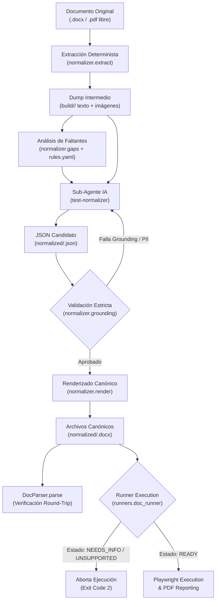

# Design: AI Test Normalizer Architecture & Specifications

## Context & Objectives
Free-form test specifications produced during manual QA or developer handoffs contain unstructured descriptions, ambiguous selectors, untyped manual steps, and varied metadata formatting. The canonical test automation pipeline (`parsers/docx_parser.py` and `runners/doc_runner.py`) requires unambiguous steps with closed-vocabulary actions and explicit target locators.

This design establishes the architecture of the `normalizer/` package and its orchestration with the `test-normalizer` subagent. The architecture guarantees deterministic extraction, strict anti-hallucination validation, canonical `.docx` rendering with round-trip fidelity, and execution gating.

## Architecture & Data Flow



### Flow Sequence
1. **Extraction**: `python -m normalizer.extract <doc> --out build/<id>/` extracts plain text, parsed tables, and embedded images.
2. **Gap Analysis**: `normalizer.gaps` scans the text against keyword rules in `normalizer/rules.yaml` to flag initial issues and assign severity.
3. **Sub-Agent Normalization**: The `test-normalizer` subagent structures the free-form text into `normalized/<id>.json`. The AI models logic, quotes, and parameters without modifying original files or invoking browser sessions.
4. **Validation**: `python -m normalizer.cli validate normalized/<id>.json --original build/<id>/` executes the 3-point grounding check. If invalid, the agent receives diagnostic feedback to correct (up to 3 attempts).
5. **Rendering**: `python -m normalizer.cli render normalized/<id>.json --out normalized/` generates one canonical `.docx` file per case, formatting the "Identificación" metadata table and standard paragraph steps.
6. **Round-Trip Assertion**: Each rendered `.docx` is parsed back using `DocParser.parse` to ensure 100% syntactic and semantic equivalence.
7. **Execution Gate**: `DocRunner` checks the "Estado de normalización" metadata cell. If `NEEDS_INFO` or `UNSUPPORTED`, it logs missing gaps and halts with exit code 2. If `READY`, it expands `${VAR}` credentials and dispatches tests.

---

## Closed Action Vocabulary
All normalized steps MUST map to one of five actions:

| Action | Form in Canonical .docx | Narrative Example in Original Document | Execution Handling in Runner |
|---|---|---|---|
| `navigate` | `Paso N: navegar a <url>` | "Ingresamos al link de la prueba" | `page.goto(url)` |
| `fill` | `Paso N: escribir <valor> en <campo>` | "Colocamos el código en el campo Código" | `LoginPage` / `UserManagementPage.fill()` |
| `click` | `Paso N: clic en <texto visible>` | "Pulsamos Emitir" | `PageObject.click(target)` |
| `verify` | `Paso N: verificar <texto visible>` | "Se muestra el mensaje Pago procesado" | `expect(locator).to_be_visible()` |
| `manual` | `Pendiente manual N: <motivo>` | "Subir archivo de póliza", "Recibir token OTP" | Skipped by `DocxParser` (never executed as click) |

> [!IMPORTANT]
> Manual steps MUST NEVER be rendered with the `Paso N:` prefix. Because `DocxParser.parse_standard_description` defaults unclassified steps to `click`, rendering manual steps with `Paso N:` would attempt to click the manual description text. They are strictly rendered as `Pendiente manual N: <motivo>`.

Dropdown selections are represented as two sequential `click` steps (open dropdown, select item). Verbs must never be forced; if an interaction does not fit `navigate`, `fill`, `click`, or `verify`, it is classified as `manual`.

---

## Gap Taxonomy & Severities
From the `canonical-test-format` specification:

| Gap Type | Severity | Condition | Action Required from User / Author |
|---|---|---|---|
| `missing_url` | `blocking` | No `Link:` or URL found in case or header | Add `Link: https://...` to the case specification |
| `missing_credentials` | `blocking` | Login step detected but no username provided | Provide test user role; password is kept in `.env` as `QA_PASS_<ROL>` |
| `credentials_in_plaintext` | `warning` | Plaintext password or secret present in original doc | Change secret and reference via environment variable `${QA_PASS_<ROL>}` |
| `missing_expected` | `warning` | Verification step only states vague outcome (e.g. "funciona correctamente") | Specify explicit visible text or UI state expected |
| `ambiguous_step` | `blocking` (if target is missing) | Step does not clearly state which UI element to interact with | Name button or input field exactly as displayed |
| `data_in_screenshot` | `warning` | Test data exists only in embedded image or is illegible | Provide synthetic test data explicitly in text |
| `unsupported_flow` | `info` | Step involves OTP, payment gateways, emails, SISIP, file uploads | No action; step remains flagged as pending manual step |

---

## Normalization States
Every normalized case is evaluated to exactly one state:
- **`NEEDS_INFO`**: Case contains at least one `blocking` gap. Automation cannot safely proceed.
- **`UNSUPPORTED`**: Case contains zero executable automated steps (all steps are manual or unsupported).
- **`READY`**: Case has no blocking gaps and contains at least one automated step. Ready for `DocRunner`.

---

## Grounding & Anti-Leakage Specification (`normalizer/grounding.py`)
To prevent LLM hallucination and confidentiality leaks, three deterministic checks are enforced before any generated JSON is accepted:

1. **Source Quote Verbatim Check**:
   - Every normalized step MUST contain a `source_quote` field.
   - The string in `source_quote` must exist as an exact substring in the extracted raw text of the document.
2. **Value Grounding & Parameterization**:
   - Every URL, username, and input value in steps must either:
     - Appear literally in the original document text or table cells, OR
     - Follow the strict environment variable syntax `${QA_USER_<ROL>}` or `${QA_PASS_<ROL>}`.
   - Hallucinated credentials or arbitrary web URLs are rejected.
3. **Anti-Leakage & PII Check**:
   - Output must contain zero real personal identification tokens:
     - Venezuelan National IDs (Cédulas): matching `r"\b[VEve]-?\d{6,9}\b"`
     - Fiscal IDs (RIF): matching `r"\b[JGVEjgve]-?\d{8,9}-?\d?\b"`
     - Personal email addresses: matching `r"[a-zA-Z0-9_.+-]+@(?!exelixi\.tech|example\.com)[a-zA-Z0-9-]+\.[a-zA-Z0-9-.]+"`
     - Plaintext passwords in step values.

---

## Canonical Document Rendering (`normalizer/render.py`)
`render.py` transforms a validated `NormalizedCase` model into a standard Word document (`.docx`):
1. **Identification Table**:
   Contains 2 rows with exact lowercase headers matching `DocxParser._extract_table_data`:
   - `Fecha`
   - `Módulo`
   - `Identificador del caso`
   - `Descripción corta`
   - `Descripción completa`
   - `Ambiente de prueba`
   - `Analista Programador`
   - `Analista de prueba`
   - `Estado de normalización` (`READY` | `NEEDS_INFO` | `UNSUPPORTED`)
2. **Metadata Paragraphs**:
   - `Link: <url>`
   - `Caso <N>: <title>`
   - `Objetivo de la Prueba: <objective>`
   - `Usuario: ${QA_USER_<ROL>}`
   - `Clave: ${QA_PASS_<ROL>}`
3. **Step Paragraphs**:
   - Automated steps: `Paso 1: navegar a <url>`, `Paso 2: escribir <val> en <target>`, `Paso 3: clic en <target>`, `Paso 4: verificar <target>`
   - Manual steps: `Pendiente manual 1: <motivo>`
4. **Round-Trip Equivalence Assertion**:
   ```python
   parsed = DocParser.parse(rendered_docx_path)
   assert parsed.case_id == original_case.case_id
   assert parsed.url == original_case.url
   assert len(parsed.steps) == len(original_case.automated_steps)
   for p_step, o_step in zip(parsed.steps, original_case.automated_steps):
       assert p_step.action == o_step.action
       assert p_step.target == o_step.target
       assert p_step.value == o_step.value
   ```

---

## Runner Integration (`runners/doc_runner.py`)
Enhancements to `doc_runner.py`:
1. **Pre-flight Gate**:
   - Read "Estado de normalización" from `test_case`.
   - If status is `NEEDS_INFO` or `UNSUPPORTED`:
     - Log explanatory message listing unresolved gaps.
     - Terminate immediately with `sys.exit(2)` (process exit code 2).
2. **Credential Interpolation**:
   - Replace `${VAR_NAME}` patterns in `test_case.credentials` with values from `os.environ`.
   - If `${VAR_NAME}` is unset in environment, log a warning and fall back to empty string, avoiding hardcoded real names or credentials.
