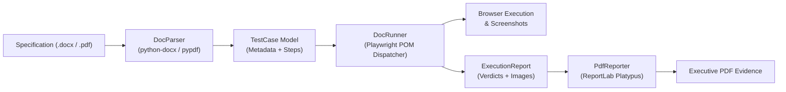
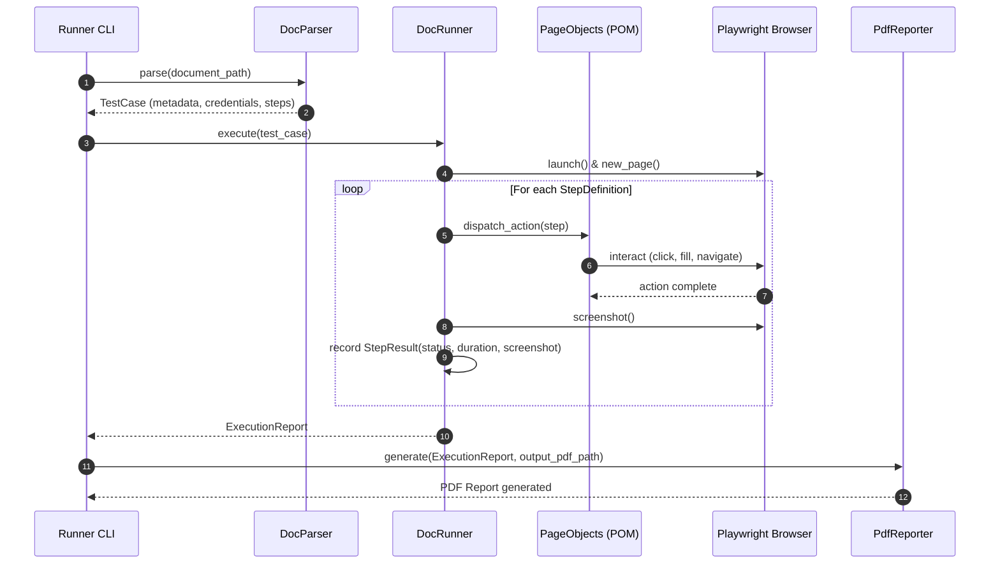

# Design: Document-Driven Testing & PDF Evidence Reporting

## Context & Objectives
Exelixi QA receives test specifications as `.docx` (generated via Steps Recorder/templates) or `.pdf` files. This design introduces an automated pipeline that ingests these documents, executes the scenarios using Playwright and Page Objects, and compiles executive PDF evidence reports with step-by-step verdicts and embedded screenshots.

## Architecture & Data Flow

### Execution Sequence

## Component Design

### 1. Data Models (`parsers/models.py`)
- `StepDefinition`: Holds `step_num: int`, `raw_text: str`, `action: str` (`click`|`fill`|`navigate`|`verify`), `target: str`, `value: Optional[str]`, `timestamp: Optional[str]`.
- `TestCase`: Holds `case_id: str`, `module: str`, `title: str`, `objective: str`, `environment: str`, `developer: str`, `url: Optional[str]`, `credentials: dict[str, str]`, `steps: list[StepDefinition]`.
- `StepResult`: Holds `step_num: int`, `action: str`, `target: str`, `status: str` (`PASSED`|`FAILED`), `duration_ms: float`, `screenshot_path: Optional[str]`, `error: Optional[str]`.
- `ExecutionReport`: Encapsulates `test_case: TestCase`, `overall_status: str`, `start_time: str`, `end_time: str`, `duration_sec: float`, `step_results: list[StepResult]`, `summary: dict[str, int]`.

### 2. Document Parser (`parsers/doc_parser.py`)
- **Interface**: `DocParser.parse(file_path: Path) -> TestCase`.
- **Format Handlers**:
  - `DocxParser`: Reads Word tables and paragraphs via `python-docx`. Extracts metadata (Case ID, Module, Analyst, Objective, Credentials) and step definitions.
  - `PdfParser`: Extracts text pages via `pypdf.PdfReader` and parses metadata and steps using regular expressions.
- **Step Normalization**: Parses PSR lines (`Step X: (timestamp) User left click on "..."`) via regex, filters out noise (`Step X screenshot.`, `Previous Next`), and normalizes action targets.

### 3. Execution Dispatcher (`runners/doc_runner.py`)
- **Core Engine**: `DocRunner` manages Playwright browser contexts (`sync_api`).
- **Hybrid Dispatching**:
  - *POM Binding*: Routes standard actions to existing Page Objects ([`LoginPage`](file:///home/fernandojosesilvatrejo/Documents/9no%20Semestre/QA_AUTOMATIZACI%C3%93N/pageobjects/login_page.py), [`UserManagementPage`](file:///home/fernandojosesilvatrejo/Documents/9no%20Semestre/QA_AUTOMATIZACI%C3%93N/pageobjects/user_management_page.py)) when matching navigation or form operations.
  - *Generic Locators*: For unmapped interactive elements, uses text/role-based locators (`page.get_by_role()`, `page.locator()`).
- **Evidence Collector**: Captures page screenshots per step, records execution timing, handles timeouts/exceptions gracefully without crashing the pipeline, and generates an `ExecutionReport`.
- **CLI**: Executable via `python -m runners.doc_runner --doc <path> --output-report <path> [--headless]`.

### 4. PDF Evidence Reporter (`reporting/pdf_reporter.py`)
- **Engine**: Pure-Python `reportlab.platypus` (`SimpleDocTemplate`, `Table`, `Paragraph`, `Image`).
- **Document Structure**:
  1. *Header & Status*: Exelixi QA title, execution date, status badge (green `PASSED` / red `FAILED`).
  2. *Metadata Grid*: Case ID, module, environment, analyst, execution duration, and pass/fail counters.
  3. *Objective & Scope*: Outlined callout containing the parsed test purpose.
  4. *Evidence Table*: Step #, action description, verdict, duration, and scaled embedded screenshot thumbnail (220x130 pt).
  5. *Pagination*: Custom `NumberedCanvas` generating "Page X of Y" and confidentiality footers.

## Architecture Decisions

| Decision | Choice | Rationale |
|---|---|---|
| Ingestion Libraries | `python-docx` + `pypdf` | Lightweight, pure-Python dependencies; avoid heavyweight OCR/Poppler binaries while parsing native `.docx`/`.pdf`. |
| Execution Dispatcher | Hybrid POM + Fallback Locators | Leverages robust existing POM classes while gracefully handling ad-hoc document steps. |
| PDF Generation | `reportlab` Platypus | Deterministic layout, automatic pagination, no external headless browser overhead (unlike WeasyPrint/Puppeteer). |
| Playwright Mode | Synchronous (`playwright.sync_api`) | Consistent with existing POM implementations ([`LoginPage`](file:///home/fernandojosesilvatrejo/Documents/9no%20Semestre/QA_AUTOMATIZACI%C3%93N/pageobjects/login_page.py), [`UserManagementPage`](file:///home/fernandojosesilvatrejo/Documents/9no%20Semestre/QA_AUTOMATIZACI%C3%93N/pageobjects/user_management_page.py)) and pytest runner. |
| Evidence Optimization | Scaled thumbnails in PDF + full PNG on disk | Keeps generated executive PDF files under 5MB while preserving full-resolution screenshots in the evidence artifact folder. |

## File Changes

| File | Change Type | Description |
|---|---|---|
| `requirements.txt` | Modified | Add `python-docx`, `pypdf`, and `reportlab`. |
| `parsers/models.py` | New | Dataclass definitions for `TestCase`, `StepDefinition`, `StepResult`, `ExecutionReport`. |
| `parsers/doc_parser.py` | New | Ingestion parser supporting `.docx` and `.pdf` files. |
| `reporting/pdf_reporter.py` | New | ReportLab executive PDF evidence generator with embedded screenshots. |
| `runners/doc_runner.py` | New | Playwright execution dispatcher and command-line runner. |
| `tests/unit/test_doc_parser.py` | New | Unit tests verifying `.docx` and `.pdf` metadata/step extraction. |
| `tests/unit/test_pdf_reporter.py` | New | Unit tests verifying PDF document construction and layout elements. |
| `tests/unit/test_doc_runner.py` | New | Unit tests verifying POM action dispatching and evidence recording. |
